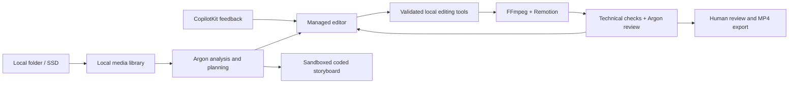

# Cutroom

A local workspace for turning a camera roll into a story, a content plan, and a vertical reel. Built for the Gemini 4 Argon SF Hackathon.

Choose a folder on your Mac or an attached SSD. Argon analyzes compact previews, proposes a narrative, and directs a managed editing loop. FFmpeg and Remotion render the result locally. Keep refining it through a CopilotKit conversation and a visual timeline.

## What is included

- **Local media library:** browse mounted folders, index photos and videos, filter by capture date, and keep originals untouched.
- **Story to reel:** source analysis, shot selection, validated cuts, rendering, visual critique, bounded repairs, and Remotion titles.
- **Conversational editing:** a self-hosted CopilotKit/AG-UI endpoint, actual tool receipts, editing summaries, and queued revisions from feedback.
- **Editing workspace:** Remotion Player preview, shot selection, trim, reorder, crop/fit, and per-shot color controls. Render changes to see the updated video.
- **Color handling:** HDR/HLG/PQ normalization to Rec.709, bounded exposure/contrast/saturation/warmth adjustments, and output color checks.
- **Plan the day:** compare evidence-supported content angles, recommend a main story and format, arrange source moments, and generate an interactive HTML/CSS/JavaScript storyboard. Generated code runs in a restricted iframe; its source is inspectable.

This is a hackathon prototype. The newer chat, color-matching, and day-planning paths are included in source but still need complete live end-to-end acceptance testing. See [verification status](docs/VERIFICATION.md).

## Run on a Mac

Requirements: Node.js **22.12+**, npm, `ffprobe` on your PATH (provided by an FFmpeg installation), and Google Chrome for Remotion rendering. The app uses the `ffmpeg-static` dependency for media conversion by default.

```sh
git clone https://github.com/jerelvelarde/hackathon-gemini-argon.git
cd hackathon-gemini-argon
npm ci
cp .env.example .env
```

Set `GEMINI_API_KEY` in `.env` to your own provisioned key, then:

```sh
npm run dev
```

Open **http://127.0.0.1:4317**. You can also enter a key through the local connection dialog for the current server session. Model and managed-agent access must be available to your account; this repository does not include credentials or grant hackathon credits.

1. Choose a folder containing your footage.
2. Choose **Find the story**, **Today**, or **My SF tech week**, then make a reel.
3. Review the preview and actual tool activity. Use chat or timeline controls to request revisions.
4. After at least three moments have analysis, use **Plan the day** for a visual story plan and proposed photo order.
5. Save a separate MP4 to a folder you choose.

For a production-mode local build, run `npm run build`, then `npm start`. Keep this single-user service on loopback; it is not an authenticated hosted application.

## Local and cloud boundaries

| Runs locally | Uses Google's API |
| --- | --- |
| Folder access, previews, metadata, FFmpeg processing, Remotion rendering, exports | Argon source understanding, content planning, generated storyboard code, visual review, and managed-agent orchestration |

Argon is **not a locally installed Mac model**. AI operations send compact visual previews and relevant metadata to Google and require internet access. Original files are not edited in place. There is no automatic social publishing.

The API key belongs in ignored `.env` or server memory. `.cutroom/` holds local previews, analysis, storyboards, run history, and exports; chat history is stored in the local browser. These artifacts and personal media are excluded from this repository. Use your own footage; no private demo assets are distributed.

## Architecture



`src/` contains the React workspace; `server/` owns local media and API orchestration; `remotion/` contains the reel composition. [Architecture decision](docs/ADR-001-local-media-managed-editor.md).

## Checks and limits

```sh
npm test
npm run build
npm run test:media
```

The media check creates synthetic footage in `.cutroom/verification/`, detects a deliberate crop defect, repairs it, and renders through Remotion. It does not call Google or use personal assets.

Current limits: 100 assets per library, individual videos from 0.5 to 120 seconds, and at most 10 minutes of source video per run. Output is a 720 × 1280 H.264 MP4. Folder rescanning is manual. No Google Photos sync, background watcher, social publishing, or cache-cleanup UI is included. Large frontend bundles remain a prototype performance limitation.

[Mac guide](docs/LOCAL-MAC.md) · [Acceptance checklist](docs/ACCEPTANCE.md) · [Hackathon context](docs/HACKATHON.md) · [Access and resources](docs/RESOURCES.md)
