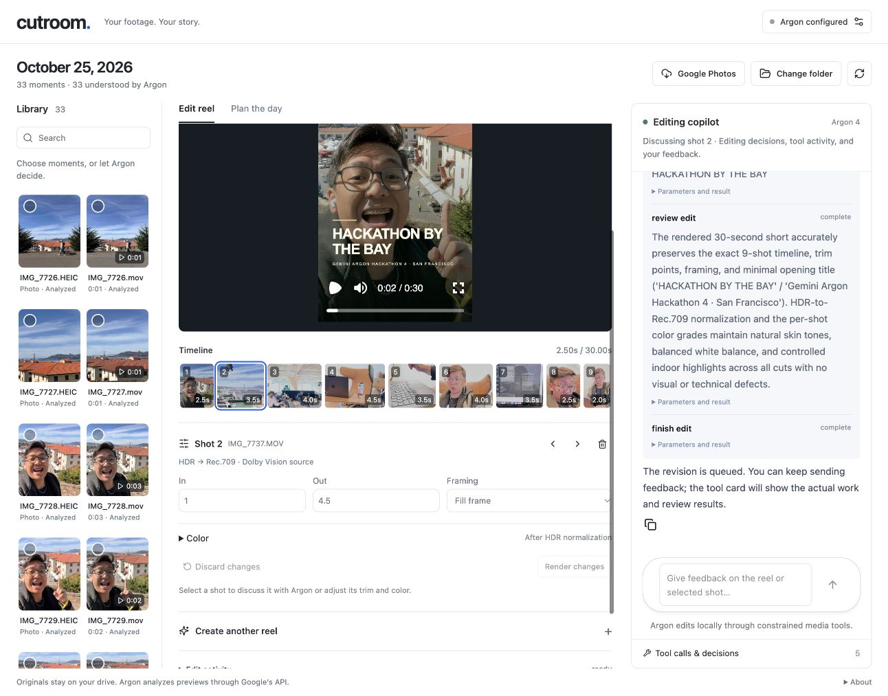
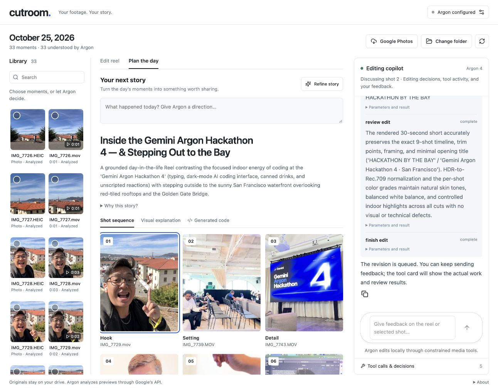
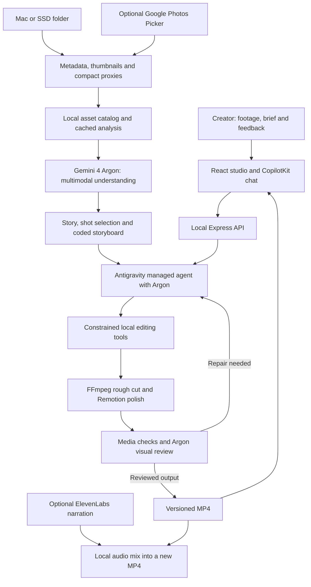

# Cutroom

**Your footage. Your story.** A local creative workspace that turns a day of photos and video into a reviewed reel—with Gemini Argon directing the edit.

[Watch the one-minute demo](https://github.com/jerelvelarde/cutroom/releases/tag/v0.1.0-hackathon) · [Run on your Mac](docs/LOCAL-MAC.md) · [Architecture](docs/ADR-001-local-media-managed-editor.md)



## From camera roll to story

1. Connect a local folder or SSD. Optionally import explicitly selected items using Google Photos Picker.
2. Argon analyzes compact previews, identifies useful moments, and proposes a main story, content angles, hook, caption, and ordered sequence.
3. Turn the plan into a vertical reel. A managed agent calls real local render, review, repair, and polish tools.
4. Keep refining through CopilotKit chat or the timeline inspector. See actual tool receipts and review findings, compare versions, and export a new file.

The story planner also lets Argon write an interactive HTML/CSS explanation. Generated documents run in a sanitized, script-free, network-isolated iframe.



## What runs where

| Component | Responsibility |
| --- | --- |
| Gemini 4 Argon | Multimodal understanding, story planning, editing decisions, and visual review through Google's API |
| Antigravity Managed Agents | Google-hosted orchestration of the tool loop |
| CopilotKit + AG-UI | Conversation, selected-shot context, real tool receipts, and ongoing feedback |
| FFmpeg / ffprobe | Local decode, trim, frame, HDR-to-Rec.709 conversion, grade, assemble, and measure |
| Remotion | Interactive player and final title treatment; the one-minute product demo |
| Google Photos Picker | Optional OAuth-based selection and local import; separate Google Cloud client setup required |
| ElevenLabs | Optional stock-voice narration, preview, and narrated-copy export |

**The model is not running on-device.** Compact previews and metadata are sent to Google for authorized analysis. Rendering and file management run on the Mac. Originals are never overwritten. Narration sends the script to ElevenLabs; credentials stay server-side.

## Agent architecture

Cutroom separates creative judgment from media execution. Google's models choose and critique the edit; a constrained local tool layer validates and executes those decisions. The browser shows the actual conversation, artifacts, and job state.



### Source understanding and story discovery

`server/source-folder.mjs`, `server/local-files.mjs`, and `server/media.mjs` index media, extract capture dates, and create normalized previews. Linked videos remain on their original drive; photos use a normalized local copy. Date-scoped stories use capture metadata or an explicitly corrected date, rather than silently treating upload time as capture time.

`server/gemini.mjs` calls the Gemini **Interactions API** with server-side credentials. It supports multimodal image/video input, structured JSON responses, background interaction polling, continuation, and cancellation. The defaults are `gemini-4-argon` for the model and `antigravity-preview-09-2026` for the managed agent. These identifiers require appropriate Google account access.

Argon analyzes the visual evidence and recommends useful shots, framing, and narrative roles. With no creative brief, it discovers a supported story and chooses source moments. Cached analysis is reused when available. It is instructed not to invent events, identities, dialogue, or chronology that the footage does not establish.

### The render–review–repair loop

`server/agent.mjs` gives the Google-hosted managed agent a narrow local function interface. The agent does not receive unrestricted shell or filesystem access to the Mac.

| Tool | What it executes | What the agent receives |
| --- | --- | --- |
| `render_edit` | Validate a structured timeline, then trim, sequence, frame, grade and render real source media | Rendered version identifier and duration |
| `review_edit` | Probe and scan the MP4, then have Argon watch a compact review video | Technical checks, timestamped visual issues and repair suggestions |
| `polish_edit` | Render Remotion titles and optional chapter captions on a reviewed rough cut | A new polished version that must be reviewed again |
| `finish_edit` | Enforce the final-review requirement and report remaining limitations | `ready` or `needs_review`, with a summary |

Zod validates tool arguments and timeline structure before rendering. Source IDs must exist, cut ranges must fit the source, and shot durations, export duration, framing, and grade values are bounded. Pending function calls are identified by their IDs so completed calls are not repeated when an interaction continues.

The loop allows up to three editorial renders. A successful rough cut receives a finish pass, followed by another review of the **actual final video**. Major remaining defects prevent a clean completion; minor editorial concerns remain visible. A passed review is not a guarantee of aesthetic perfection.

### Conversational editing and version history

`server/chat.mjs` exposes an **AG-UI server-sent event stream** to a self-managed `HttpAgent` in CopilotKit. Argon routes each message into an answer, a story-planning request, an edit, or an explicit stop request. The interface renders genuine tool receipts and concise editing decisions, not fabricated progress or private model reasoning.

Revisions preserve the parent timeline unless the request requires changes. A serialized local job queue prevents overlapping media renders, while chat remains available for further feedback. Prior cuts remain available for comparison and export. Chat history persists in the browser; the asset catalog, cached analysis, plans, runs, and exports persist in the local data directory.

### Generated visual explanations

`server/storyboard.mjs` asks Argon for a main story, editorial angles, hook, caption, ordered source sequence, and self-contained HTML/CSS. Source IDs are validated and replaced with real local thumbnails. Rankings describe editorial fit, not predicted engagement.

Generated markup is sanitized and displayed in an isolated iframe with a restrictive content security policy. Scripts, forms, network access, and access to the parent application are blocked; native disclosure elements provide interaction. Generated code is never executed by the Node server.

### Color management and verification

`server/color.mjs` detects HLG/PQ sources, converts HDR to SDR Rec.709, and applies bounded brightness, contrast, saturation, and warmth adjustments. `server/polish.mjs` preserves explicit Rec.709 metadata after the final Remotion render.

Each review combines deterministic checks—**720 × 1280 dimensions, duration, valid source ranges, no detected black gaps, audio presence, and color metadata**—with Argon's visual assessment of framing, continuity, exposure, white balance, saturation, and title readability. Media measurements and subjective visual judgments are reported separately.

In a real hackathon run, **33 photos and videos** produced a **nine-shot, 30.34-second reel**. One completed version passed all six technical checks and returned no visual issues. A later manual grade preserved the creator's choices while surfacing a minor saturation warning, rather than hiding it to claim a perfect result.

## Technology stack

| Layer | Technology | Purpose |
| --- | --- | --- |
| Multimodal reasoning | Gemini 4 Argon | Footage understanding, story discovery, editing decisions, generated visualizations and output critique |
| Agent orchestration | Google Antigravity Managed Agents + Interactions API | Stateful tool-driven execution, review and repair |
| Application UI | React 19, Vite 7, Lucide | Local media library, planning canvas, studio and settings |
| Conversational UI | CopilotKit + AG-UI | Streaming feedback, selected-shot context, tool receipts and job progress |
| Local server | Node.js 22+, Express 5 | Source access, model calls, job coordination, integration endpoints and exports |
| Media engine | FFmpeg, ffprobe | Decode, trim, frame, tone-map, grade, encode, mix audio and inspect outputs |
| Compositions | Remotion Player, Renderer and Bundler | Interactive preview, title treatment and demo composition |
| Photos and metadata | Sharp, exifr | Photo normalization, thumbnails and capture metadata |
| Runtime contracts | Zod | Validation at model, tool and API boundaries |
| Generated-code isolation | sanitize-html, iframe sandbox, CSP | Restricts generated storyboards to display markup and styles |
| Optional import | Google Photos Picker API + OAuth/PKCE | Imports only explicitly selected photos and videos |
| Optional voiceover | ElevenLabs JavaScript SDK | Stock synthetic narration and local narrated-copy export |
| Persistence | Local JSON and media files | Asset catalog, cached analysis, versioned plans and exports |
| Testing | Node.js built-in test runner | Contracts, media behavior, provider boundaries and isolation |

## Source map

```text
src/                       React workspace, studio, copilot and integration dialogs
server/agent.mjs           Managed-agent tool loop and revision queue
server/chat.mjs            AG-UI conversational endpoint
server/gemini.mjs          Gemini Interactions API client
server/storyboard.mjs      Story planning and isolated generated visualization
server/media.mjs           Ingestion, rendering and technical checks
server/color.mjs           HDR normalization and bounded grading
server/polish.mjs          Remotion finish and final color tagging
server/google-photos*.mjs  OAuth, picker and selected-media import
server/voiceover.mjs       ElevenLabs generation and local narration mixing
remotion/                 Reel title and motion composition
demo/                     One-minute product-demo composition and script
scripts/                  Rendering and local verification utilities
tests/                    Automated contracts and integration boundaries
docs/                     Workflow, architecture, acceptance and event references
```

## Run locally

Requires Node.js 22.12+, `ffprobe`, and Google Chrome for Remotion. FFmpeg is bundled with the project.

```sh
git clone https://github.com/jerelvelarde/cutroom.git
cd cutroom
npm install
cp .env.example .env
# Set GEMINI_API_KEY in .env (never commit credentials).
npm run dev
```

Open **http://127.0.0.1:4317/**. The server binds to loopback and rejects remote Host headers and cross-origin writes. The hackathon model identifiers require provisioned access; they are configurable in the environment.

- [Local folders, reels, and troubleshooting](docs/LOCAL-MAC.md)
- [Google Photos OAuth setup](docs/GOOGLE-PHOTOS.md)
- [ElevenLabs voiceover setup](docs/VOICEOVER.md)

## Verification and limitations

```sh
npm test
npm run build
npm run test:media
```

The test suite covers timeline bounds, color conversion, safe local media handling, generated-document isolation, Google Photos OAuth/import behavior with mocked provider endpoints, and voiceover validation. The media test renders synthetic fixtures without AI. The hackathon demo uses actual footage, actual interface captures, and a real Argon-reviewed reel; it is an edited walkthrough, not a claim that analysis completes in one minute.

Prototype limits: 100 assets per library, source clips 0.5–120 seconds, up to 10 minutes of video per edit, 6–60-second reels, 720×1280 reel output. Source analysis is cached; cold analysis takes longer than a cached revision. Manual rescan replaces background file watching. Visual review is model judgment, not a guarantee of editorial quality. No automatic social publishing or multi-user cloud service.

Google Photos account import requires the user's OAuth client and consent. Integration tests use mock Google endpoints; live account import has not been verified in this build.

## Demo assets

The published screenshots and demo contain the creator's hackathon footage with explicit permission. Raw SSD originals, cached analysis, credentials, and editing history remain excluded from Git. The demo composition is in `demo/Composition.jsx`; `scripts/render-demo.mjs` takes an ignored local manifest of cleared media paths. See [the demo script](demo/SCRIPT.md).

Built during the Gemini Argon hackathon, October 25, 2026. UI refinement follows the [Impeccable design guidance](https://impeccable.style/designing/) and the product's familiar source / canvas / copilot workflow. See [PRODUCT.md](PRODUCT.md) and [DESIGN.md](DESIGN.md).
