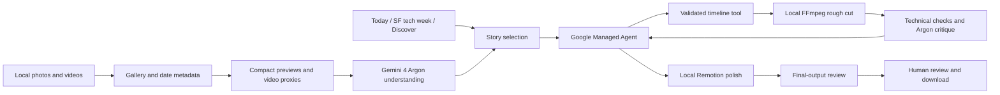

# ADR 001 — local media, Gemini understanding, managed editing

**Status:** accepted; provisioned Argon and managed-agent access verified with live requests.

**Date:** October 25, 2026.

## Context

Cutroom must turn 50–100 personal photos/videos into a polished reel with minimal user direction. The hackathon values a live working demo, meaningful Gemini 4 Argon usage, and a real verification loop. The Managed Agents prize makes Google-managed orchestration a central part of the implementation. Personal assets must not be committed to GitHub.

## Decision

Use a single-user local Node application with a React interface. Read originals directly from a user-selected local or SSD folder. Store normalized photos, previews and run artifacts in ignored `.cutroom/` storage. The minimalist interface uses folder selection, story choice, review and export; editing never overwrites originals. Send compact visual previews to Gemini 4 Argon for understanding and critique. Use Antigravity Managed Agents through the Interactions API to choose and execute constrained editing tools. Render media locally using FFmpeg and Remotion.

## Boundaries

- **Local media layer:** owns original files, decoding, thumbnails, date extraction, FFmpeg/Remotion rendering, and downloads.
- **Gemini understanding:** owns descriptions, useful source ranges, narrative grouping, selection, and visual assessment. It cannot publish assets.
- **Managed editor:** owns the tool-use loop. It receives a compact asset catalog and invokes typed operations; no arbitrary model-generated shell commands execute on the host.
- **Tool validation:** source IDs must resolve to the active library, time ranges must be in bounds, and focal coordinates/durations must be finite and bounded.
- **Presentation:** reports tool actions, evidence, real errors, and unresolved issues. It does not manufacture agent activity or expose hidden reasoning.

The current managed-agent endpoint documents text/image inputs. Video understanding is delegated to a direct Argon model request through a local tool; video bytes are not assumed to be a supported native managed-agent input.

## State and privacy

- File-backed JSON is adequate for this single-user hackathon; writes are serialized and atomic.
- Keep keys in process memory or ignored `.env`. Browser receives connection status only.
- Analysis caches are local and keyed to assets/model. A fresh file gets a fresh ID; metadata corrections affect eligibility without inventing capture dates.
- Listen on loopback and reject cross-origin writes. This is not an authenticated internet-facing service.
- Send only task-relevant previews/metadata to Google. Private Gemini analysis was explicitly authorized; public publication of personal media was not.
- Git includes source, docs, and synthetic-fixture generators only. Raw fixtures and all personal artifacts remain ignored.

## Why these choices

| Alternative | Reason not selected for MVP |
| --- | --- |
| Upload whole library to a public/static hosted app | Unnecessary for a local demo; complicates privacy and large-media execution |
| Make every edit a direct model completion | Weak demonstration of managed-agent runtime and iterative tool execution |
| Execute arbitrary generated scripts locally | Typed timeline/tools provide a smaller, inspectable execution boundary |
| Full Google Photos account sync | Adds auth/access complexity before the core story-to-reel loop is proven |
| Remotion for all ingest and analysis | FFmpeg is simpler for normalization and objective checks; Remotion adds the final motion-design layer |
| Fully local visual model | Would not demonstrate the requested Gemini visual understanding; user authorized private API analysis |

## Consequences and limits

- The managed agent runs at Google, while custom media tools execute locally. The demo must describe this accurately.
- Account/model access, API behavior, and cost/quotas must be verified with the hackathon account; the app does not silently substitute another provider.
- Preview analysis can miss small details; surface uncertainty and retain original-resolution exports.
- Cold analysis of 100 items may take longer than the judging slot. Cache validated source analysis and execute a short real revision live.
- Artistic assessment remains subjective. Technical checks and visual critiques are shown separately.
- Remotion adds a browser-rendering dependency. Verify it early and retain rough cuts if polish fails; do not label an unpolished fallback as finished.

## References

- [Participant guide](https://cerebralvalley.ai/e/gemini-4-argon-sf/details)
- [Google hackathon builder guide](https://docs.google.com/document/d/1kN0n6hPNNTIHMVqf5-hDACrZuIg4KFrWiYpla4WQW8w/edit)
- [Managed-agent API](https://ai.google.dev/gemini-api/docs/antigravity-agent)
- [Video understanding](https://ai.google.dev/gemini-api/docs/video-understanding)
- [Remotion renderer](https://www.remotion.dev/docs/renderer/render-media)
