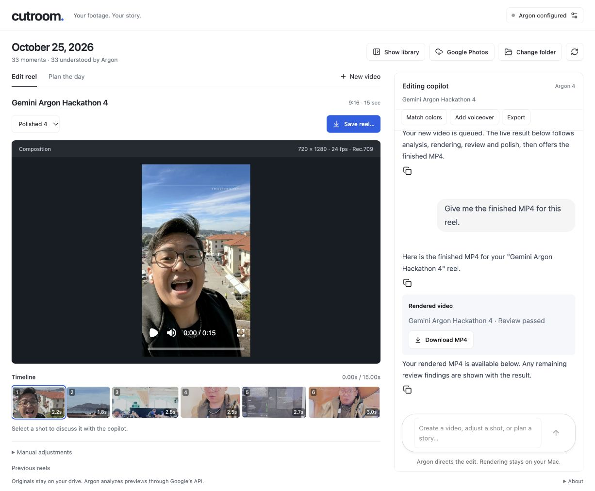

# Publication verification

## Agent-first workspace update

Verified October 25, 2026 with the configured Argon account and approved hackathon footage:

- All 24 automated tests and the production build pass. Tests cover fresh-video creation, selected-reel isolation, repeated-request replay, export review state, errors, and workspace commands.
- In the real CopilotKit UI, **New video → Create video** created a separate 15-second, six-shot reel with no parent edit. Argon rendered, reviewed, refined color, and added a minimal title. The fourth version passed technical and visual review.
- The copilot's **Export** action returned that final version. Its downloaded MP4 matched the rendered file's SHA-256 hash. FFprobe confirmed H.264 video at 720×1280, AAC audio, and Rec.709 primaries, transfer and matrix tags.
- Chat-controlled library hiding and a fresh New video conversation were exercised. Manual adjustments stay collapsed. Desktop, 900px and 390px layouts were inspected; the narrow layout had no horizontal overflow. Browser console errors were empty during QA.
- Minimal title polish accepts an empty caption list. This contract fix was added after the live run encountered that input and successfully recovered with explicit empty captions.

The earlier verification sections below describe historical coverage; they are not claims that every feature has now been tested live. Google Photos OAuth and all possible edit instructions remain outside this check.

## Polished demo update

The subsequent polished build passes all 17 automated tests and the production build. Its 60-second, 1920×1080 demo includes actual interface captures, approved hackathon footage, and 54.56 seconds of ElevenLabs stock-voice narration. Voice playback was checked in the local app. Screenshots show the editor, story planner, generated visualization code, and color review.

Google Photos tests use mocked provider endpoints; live account import still requires OAuth client setup and consent. Source scans excluded configured credential values, raw originals, and private cache files. The screenshots and release video are explicitly approved public media.

## Initial source publication

Checked October 25, 2026 on the isolated source snapshot used for this public update.

| Check | Result |
| --- | --- |
| `npm test` | Passed: 10 contract and local-file tests |
| `npm run build` | Passed; dependency directive and large-chunk warnings remain |
| `npm run test:media` | Passed with local server and Chrome access: synthetic footage → real render → detected crop defect → repaired render → Remotion polish → final review |
| Public-source scan | No configured credential values or common secret signatures found; no personal media, cache, generated storyboard, or export files included |

The media test initially detected missing color primaries and transfer tags in the Remotion output. The publication snapshot sets the renderer's `colorSpace` to `bt709`, and the complete synthetic pipeline then passed, including the output color check. The test uses generated fixtures and does not call Google.

These checks do **not** establish complete live acceptance of CopilotKit feedback, queued revisions, HDR source grading, generated day plans, or sandboxed storyboard interactions. Those paths need end-to-end testing with an appropriately provisioned account and user-approved footage. The acceptance checklist remains a test plan, not a blanket completion claim.

GitHub Actions runs dependency installation, unit tests, and the frontend build. It does not use API credentials or run the Mac/Chrome media integration check. A local pass does not imply that hosted CI has completed.

This publication was prepared separately from the active editing checkout. Personal source folders, local API configuration, and running app processes were not changed by publishing it.
